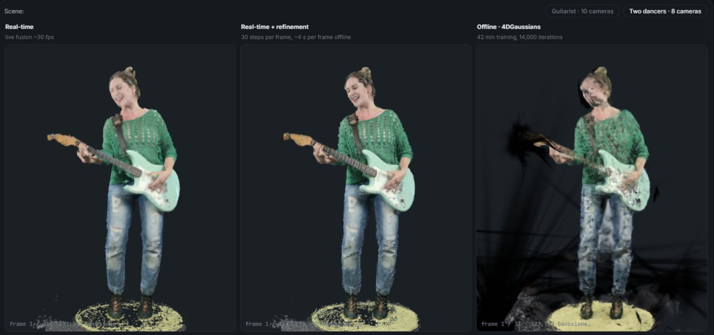

# Real-time Gaussian-Splat Volumetric Capture

### ▶ Project page: **https://abdulrehman786302.github.io/realtime-gaussian-capture/**

Performers captured with a calibrated multi-camera RGB-D rig (10 or 8 Azure Kinect / Orbbec cameras), fused into
Gaussians **frame by frame in real time** (about 30 fps, no per-scene training), recorded as compact SPZ sequences and
viewable in the browser. An automatic offline refinement after each recording sharpens the recorded Gaussians.

**On the page:**
- **Interactive 3D viewer:** a guitarist and two dancers, each in three synchronised views: real time, real time +
  refinement, and the offline method 4DGaussians.
- **Held-out camera evaluation:** one camera left out of everything and used only to score the result (PSNR / SSIM /
  LPIPS), with side-by-side videos.
- **What made the difference:** every change, measured, kept or removed.
- **Limitations.**

## Results (on a camera left out of the fusion)

| Take | Real-time | Real-time + refinement | 4DGaussians (offline) |
|---|---|---|---|
| Guitarist, 10 cameras (average of 3 held-out cameras) | **21.5 dB** | +0.2 dB (front camera) | 17.0 dB |
| Two dancers, 8 cameras | 22.7 dB | +1.1 dB | **23.7 dB** |

PSNR inside SAM 2 outlines of the performers at 640×360. The real-time pipeline is ahead on a single performer and
behind on fast motion, where 4DGaussians' optimisation over the whole clip pays off; the depth-anchored offline
refinement adds +0.2 to +1.1 dB.

## This repository

The project page only: a static `index.html` (no build step) and its media in `assets/`, served by GitHub Pages from
`main` / root. The capture pipeline itself (Unity) is not public.
